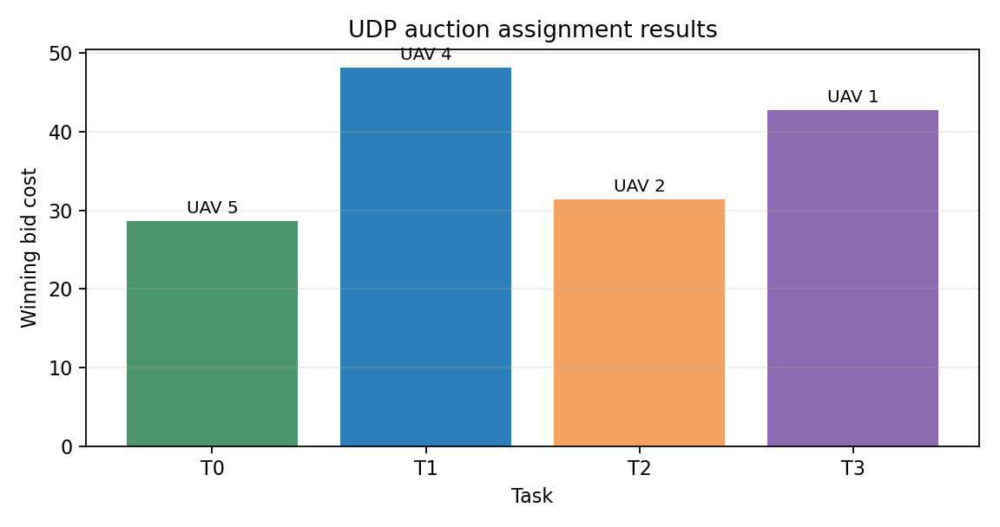

# MissionMesh: UDP Task Allocation for UAV Teams

An event-driven task allocation example for a multi-UAV team. A ground station broadcasts three task bids, and each simulated UAV replies with a bid computed from distance, battery, and payload capability. The station assigns each task to the lowest valid bid.

## Run

```text
python auction_demo.py --agents 6 --tasks 4
```

The demo uses only localhost UDP sockets and JSON datagrams. It is useful for testing message schemas, bid deadlines, and deterministic assignment logic before connecting a real vehicle interface.

## Protocol

1. `TASK_ANNOUNCE` includes task coordinates and payload demand.
2. Each vehicle returns `BID` with estimated cost and capability fields.
3. The station selects the lowest-cost valid bid before the deadline.

The project intentionally separates auction logic from vehicle autonomy. No real flight command is generated.



The plot shows winning bid costs and the selected vehicle for each task.

## License

MIT
